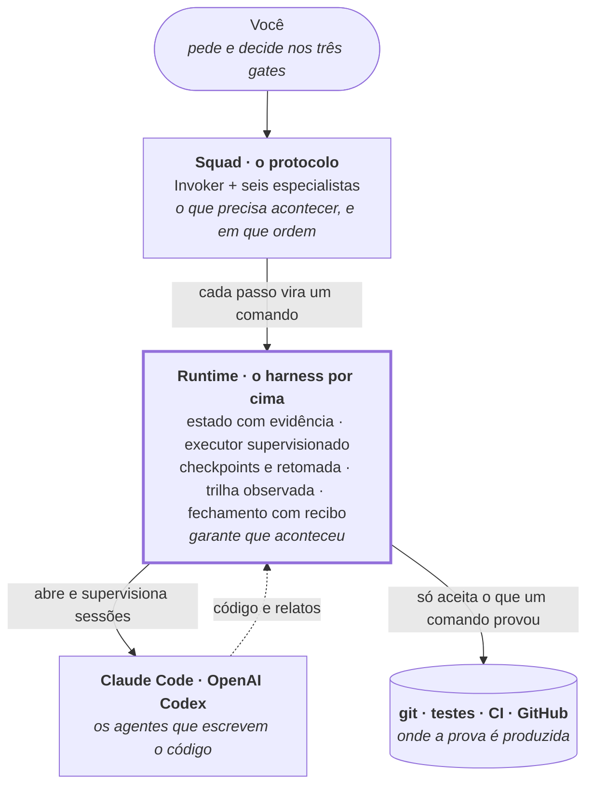
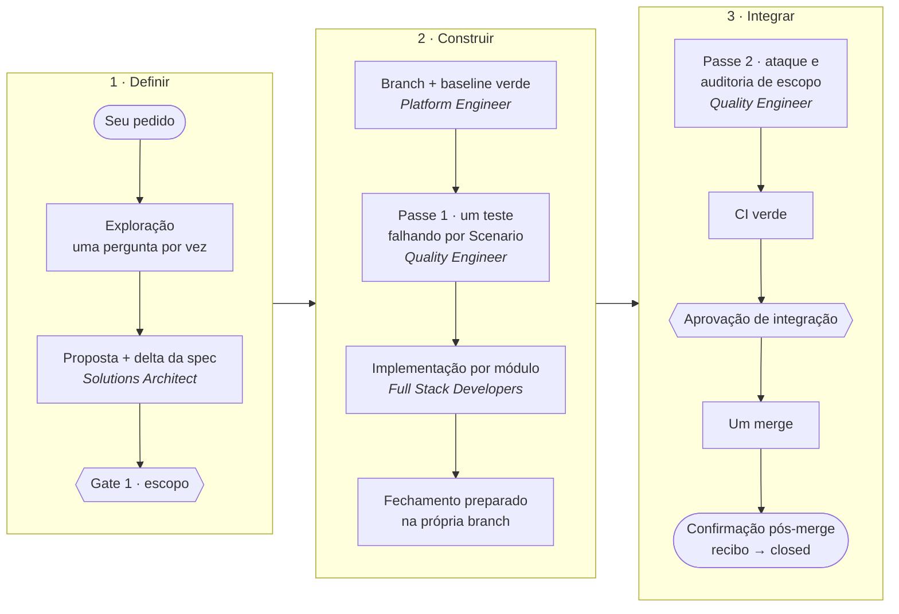

# Spectree Invoker

**O runtime que só aceita como pronto o que um comando provou — o harness que roda por cima do Claude Code e do OpenAI Codex, e o squad de agentes que ele executa.**

[](https://github.com/Spectree-Tecnologia/spectree-invoker/actions/workflows/check.yml)
[](https://github.com/Spectree-Tecnologia/spectree-invoker/tags)
[](LICENSE)


Um agente de código escreve o código. O **runtime** do Spectree Invoker decide se aquilo está pronto: roda os agentes como sessões supervisionadas, verifica com os próprios comandos, guarda o estado em disco e **recusa avançar sem evidência** produzida por um comando e presa ao conteúdo em que rodou. Em cima dele trabalha o **squad**: o Invoker, um TechLead que entrevista antes de propor, e seis especialistas que levam a mudança da ideia ao merge.

O squad diz o que precisa acontecer. O runtime garante que aconteceu. Feito para monólitos modulares guiados por especificação, sem dependência de API paga para funcionar e sem amarra a um único fornecedor de modelo.

---

## Por que existe

Um agente de código sozinho é ansioso: transforma um pedido vago em código confiante e errado, declara "pronto" sobre o próprio trabalho, aprova o que ele mesmo construiu e, quando a sessão cai, leva o contexto junto. O Spectree Invoker troca confiança por prova.

| Sem ele | Com o Spectree Invoker |
|---|---|
| O agente declara que terminou | O runtime só aceita evidência produzida por um comando, vinculada ao conteúdo em que rodou |
| Pedido vago vira código confiante e errado | A exploração entrevista antes de propor — **uma pergunta por vez** |
| Quem constrói é quem aprova | O Quality Engineer ataca em **contexto isolado** e entrega um teste que falha, nunca uma opinião |
| A sessão cai e o trabalho se perde | Checkpoints em disco: a retomada lê o estado, não a conversa |
| O requisito se perde entre a conversa e o código | Spec viva, alterada por delta; cada `Scenario` vira um teste |
| O fechamento gera PRs e commits de "o CI passou" | **Um PR por mudança**; a confirmação pós-merge produz um recibo, não um commit |
| O humano aprova tudo — e passa a aprovar sem ler | Você entra em **três gates**: escopo, ambiguidade comprovada e o que é irreversível |

## Duas camadas



O relato de um agente nunca é evidência. Evidência é o que o runtime observou: um teste que ele mesmo rodou, numa revisão que ele mesmo mediu.

## O runtime

- **Estado com evidência.** A máquina de estados (`state.mjs`) só transita com a evidência que o estado de destino exige. Um teste que passou antes de uma edição não vale depois dela, e um "pronto" num checklist não autoriza nada.
- **Executor supervisionado.** O executor (`tasks.mjs`) abre sessões não interativas e efêmeras do Claude Code (`claude -p … --permission-mode dontAsk`) e do Codex (`codex exec --sandbox …`), uma tarefa por vez, com as ferramentas que a missão autoriza e um orçamento de tentativas. Quem roda os testes de aceite é o executor, nunca o agente.
- **Checkpoints e retomada.** Cada operação registra suas fases em disco antes dos efeitos (`work.mjs`). Um efeito incerto é inspecionado e reconciliado antes de qualquer nova tentativa, e uma ponte persistente (`bridge.mjs`) guarda o resultado de um agente mesmo se o orquestrador cair no meio.
- **Trilha observada.** Toda tentativa é registrada antes de o agente ser chamado. Custo ou modelo desconhecidos ficam como desconhecidos — nunca como zero. A [Console](docs/console.md) lê essa trilha.
- **Fechamento com recibo.** A consolidação da spec acontece na própria branch, antes do merge; depois dele, a confirmação compara o que entrou com o candidato aprovado e só então grava o recibo que os estados finais exigem.
- **Um runtime, dois fornecedores.** O mesmo protocolo é gerado para o Claude Code e para o Codex; nada no runtime depende de um modelo específico.

## O squad — o protocolo

Os papéis não seguem o organograma. Seguem três fronteiras com consequência física: **raio de destruição**, **isolamento de contexto** e **adversarialidade**.

| Agente | Entrega | Fronteira |
|---|---|---|
| **Invoker** | despacho, verificação independente, o relatório para você | orquestra; não escreve código |
| **Solutions Architect** | entrevista, proposta, delta da spec e mapa de módulos | descoberta, arquitetura e UX num papel só |
| **Full Stack Developer** ×N | o módulo, com os testes que provam cada `Scenario` | um por módulo, em paralelo |
| **Quality Engineer** | um teste que falha — nunca uma opinião | adversário, em contexto isolado |
| **Platform Engineer** | branch, CI, banco, migração, merge e deploy | o único com raio de destruição em git, banco e produção |
| **Integration Engineer** | um fato sobre um sistema externo, com fonte citada | a rota geral para a rede; não escreve nada |
| **TypeSafe Engineer** | julgamentos tipados com o Jev, com calibração medida | opcional: só quando a stack aprovada inclui TypeSafe |

## Como uma mudança anda

O squad segue este pipeline; o runtime trava cada seta.



O ciclo completo, com cada regra e o porquê dela, está em [docs/workflow.md](docs/workflow.md).

## Início rápido

**Requisitos:** Node.js ≥ 20.11 e Git. Para a confirmação pós-merge, a [GitHub CLI](https://cli.github.com/) (`gh`) autenticada.

### Claude Code

```bash
claude plugin marketplace add Spectree-Tecnologia/spectree-invoker
claude plugin install spectree@spectree-invoker
```

Dentro de um projeto, rode `/spectree:invoker`. Sem argumento, ele relata o estado lido do disco; com argumento, leva o pedido para dentro do pipeline.

```text
/spectree:invoker Quero um módulo de cobrança via Pix
```

Para atualizar: `claude plugin update spectree@spectree-invoker`. Cada merge na `main` publica uma tag `v<versão>`, então dá para saber exatamente qual commit um projeto está rodando.

### OpenAI Codex

O instalador roda em modo de simulação por padrão e só escreve com `--apply`:

```bash
git clone https://github.com/Spectree-Tecnologia/spectree-invoker
node spectree-invoker/scripts/install-codex.mjs /caminho/do/projeto            # mostra o plano
node spectree-invoker/scripts/install-codex.mjs /caminho/do/projeto --apply    # instala
```

Depois, invoque com `$spectree-invoker`. Os especialistas vão para `.codex/agents/`, onde o Codex procura agentes personalizados, e o runtime vai para `.spectree/squad/`. O instalador **nunca reescreve o seu `AGENTS.md`**: acrescenta um ponteiro, uma vez, abaixo do que já existe. Para atualizar, rode de novo com `--apply --force`. Detalhes em [docs/install.md](docs/install.md).

## Veja funcionando

Duas interfaces locais rodam a partir de um clone deste repositório.

```bash
npm run console -- --demo                     # Spectree Console com dados sintéticos
npm ci --ignore-scripts && npm run presence   # Spectree Presence, demonstração
npm run presence -- --codex                   # Presence P2, conversa textual com Codex
```

- **[Spectree Console](docs/console.md)** — a trilha do runtime em modo somente leitura: pipeline, especialistas, tarefas, tentativas, evidências e histórico. Aponte para um projeto real com `npm run console -- --project /caminho/do/projeto`. O endereço impresso carrega uma credencial temporária da sessão; não o compartilhe.
- **[Spectree Presence](docs/presence.md)** — personagem 3D, identidade por cor e estados explícitos. O modo demonstrativo usa áudio gravado; o [modo Codex](docs/presence-codex.md) oferece conversa real por texto em canário isolado. Ainda sem microfone, voz ao vivo ou acesso a projetos.

## O que está comprovado — e o que não está

Este repositório prefere escrever *implementado, validação real pendente* a escrever *compatível*.

- ✅ **Claude Code desktop e OpenAI Codex Desktop** carregaram o squad em sessões reais: boot, despacho de especialista e recusa de gate.
- ✅ **O executor abriu uma sessão real do Codex** num projeto sintético: o agente implementou, e o runtime verificou o aceite rodando o teste nomeado. As pré-condições do ciclo foram montadas no fixture — não foi o pipeline completo. O executor do Claude Code nativo foi validado com a versão 2.1.234.
- ✅ **Ciclo contra o GitHub real**: um PR, um merge e a confirmação pós-merge com recibo. Um merge cujo conteúdo não era o candidato aprovado foi recusado sem recibo e sem mudança de estado.
- ✅ **Isolamento de contexto do Quality Engineer no Claude Code**, observado por sonda de despacho com braço de controle: ele não recebe a conversa nem o raciocínio de quem construiu. É isolamento de contexto, não sandbox — ele ainda compartilha o sistema de arquivos e o histórico do git.
- ⏳ **Isolamento no Codex**: ainda não sondado. Até ser, o passe 2 fica bloqueado lá.
- ⏳ **Tempo de entrega**: a estrutura (um PR, um merge, nada depois) é testada; o tempo de relógio ainda é hipótese.
- ⏳ **macOS**: nunca executado.

O registro completo, com o que rodou, onde e como, está em [docs/compatibility.md](docs/compatibility.md) e [docs/maintenance.md](docs/maintenance.md).

## Estrutura do repositório

Uma fonte, duas renderizações: `protocol/` é a única fonte autoritativa do squad, e o que o Claude Code e o Codex leem é **gerado** a partir dela e verificado no CI.

| Caminho | Conteúdo |
|---|---|
| `protocol/` | O squad, neutro de fornecedor: as seções do protocolo e o corpo de cada papel. **Edite aqui.** |
| `adapters/claude-code/`, `adapters/codex/` | O que é específico de cada fornecedor: tokens, ferramentas, metadados |
| `CLAUDE.md`, `agents/`, `adapters/codex/dist/` | **Gerados.** Rode `npm run build`; nunca edite à mão |
| `scripts/` | O runtime: a linha de comando abaixo e as bibliotecas em `scripts/lib/` |
| `schemas/` | Os contratos estruturados: mudança, despacho, evidência, aprovação, adiamento, preparação e recibo |
| `tests/`, `evals/` | Suíte determinística e avaliações com agentes reais em projetos sintéticos |
| `console/`, `presence/` | As duas interfaces locais |
| `bench/` | [Medição de performance](docs/performance.md), nunca autoridade para gates |
| `docs/` | A documentação, abaixo |

### O runtime na linha de comando

| Comando | Para quê |
|---|---|
| `state.mjs` | A máquina de estados: abrir mudanças, registrar evidência e aprovações, transitar, [planejar o próximo passo](docs/planning.md) |
| `tasks.mjs`, `bridge.mjs` | O executor: tarefas com dependências e orçamento, sessões supervisionadas, [execução resiliente](docs/resilient-execution.md) |
| `work.mjs`, `verification.mjs`, `mutation-probe.mjs` | [Retomada e verificação](docs/reliability.md): checkpoints, plano de verificação, mutação em cópia descartável |
| `prepare-closure.mjs`, `post-merge.mjs` | Preparar o fechamento na branch e [confirmar o merge com recibo](docs/workflow.md) |
| `delivery.mjs` | [Confiabilidade de entrega](docs/delivery-reliability.md): a suíte inteira contra os cenários e o inventário de testes |
| `reports.mjs`, `evals.mjs` | [Diagnóstico, revisão e avaliações](docs/evolution.md) com agentes reais |
| `adopt.mjs`, `reconcile.mjs` | [Adoção operacional](docs/operational-adoption.md) e [reconciliação guiada](docs/guided-reconciliation.md) de projetos existentes |
| `capabilities.mjs` | O que o Claude Code ou o Codex de fato oferecem ao squad, e com que grau de certeza |
| `install-codex.mjs` | O instalador para o Codex |

## Desenvolvimento

```bash
npm ci --ignore-scripts   # dependência local do renderer do Presence
npm run build             # regenera os artefatos a partir de protocol/
npm run check             # deriva + integridade + suíte — o mesmo portão do CI
```

Contribuições são bem-vindas; leia o [guia de contribuição](CONTRIBUTING.md) antes de abrir um PR. Os artefatos que o squad produz nos projetos — specs, código, commits, cards — são em inglês. Tudo que chega a você é em português. Este repositório é a ferramenta, não um projeto do squad: a história dele é em português.

## Documentação

- **Começar** — [instalação, verificação, atualização e remoção](docs/install.md) · [compatibilidade](docs/compatibility.md)
- **Entender** — [arquitetura](docs/architecture.md) · [ciclo de entrega](docs/workflow.md) · [manutenção e limites conhecidos](docs/maintenance.md)
- **O runtime** — [próximo passo](docs/planning.md) · [retomada e verificação](docs/reliability.md) · [execução e avaliações](docs/evolution.md) · [execução resiliente](docs/resilient-execution.md) · [confiabilidade de entrega](docs/delivery-reliability.md) · [runtime conectado](docs/runtime-connected.md)
- **Projetos existentes** — [adoção operacional](docs/operational-adoption.md) · [reconciliação guiada](docs/guided-reconciliation.md)
- **Interfaces** — [Console](docs/console.md) · [Presence](docs/presence.md)

## Como o plugin evolui

O [roadmap](docs/ROADMAP.md) registra a sequência aprovada de evolução do **Spectree Presence**: uma interface de conversa por voz com o Invoker e os especialistas. A versão **1.15.0** acrescenta a sessão textual local com Codex à fundação visual da 1.14.0. Voz e participação real dos especialistas permanecem nas próximas etapas.

A [P2 conecta uma conversa por texto ao Codex local](docs/presence-codex.md): `npm run presence -- --codex`. Usa login ChatGPT existente e um canário próprio, sem abrir projetos consumidores.

Um **projeto canário** roda a metodologia de verdade, sem ninguém segurando a mão. O que o canário faz de diferente do que está escrito é achado; achado vira PR aqui, nunca correção lá. Seis dos artefatos e regras deste repositório nasceram assim — o squad inventou a guarda antes de a metodologia tê-la, e a metodologia a adotou.

## Licença

[MIT](LICENSE) © 2026 Spectree Tecnologia
