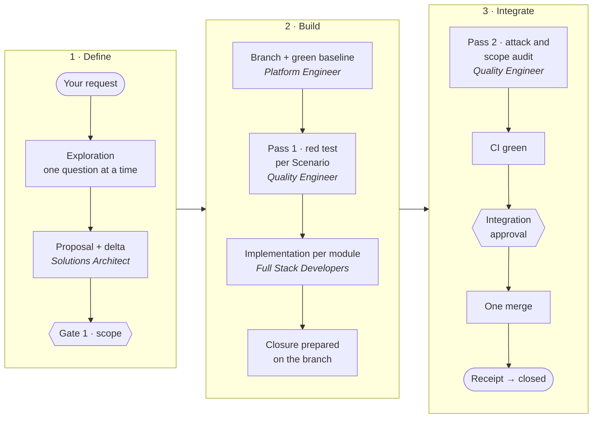

<p align="center">
  
</p>

<h1 align="center">Spectree Invoker</h1>

<p align="center">
  <b>The agent writes the code. The runtime only accepts as done what a command has proven.</b><br>
  For teams that hand whole features to Claude Code or OpenAI Codex inside a modular monolith and need proof, not a "done".
</p>

<p align="center">
  <a href="https://github.com/Spectree-Tecnologia/spectree-invoker/actions/workflows/check.yml"></a>
  <a href="https://github.com/Spectree-Tecnologia/spectree-invoker/tags"></a>
  <a href="LICENSE"></a>
  
  
  
</p>

## Quick start

**Requirements:** Node.js 22.23.4+, 24.22.1+ or 26.12.1+, and Git. To confirm merges, an authenticated [GitHub CLI](https://cli.github.com/) (`gh`).

**Claude Code**

```bash
claude plugin marketplace add Spectree-Tecnologia/spectree-invoker
claude plugin install spectree@spectree-invoker
```

Inside your project, run `/spectree:invoker`. With no argument it reports the state read from disk; with a request, it takes the request into the pipeline:

```text
/spectree:invoker I want a Pix billing module
```

**OpenAI Codex** — the installer is a dry run by default and only writes with `--apply`:

```bash
git clone https://github.com/Spectree-Tecnologia/spectree-invoker
node spectree-invoker/scripts/install-codex.mjs /path/to/project            # shows the plan
node spectree-invoker/scripts/install-codex.mjs /path/to/project --apply    # installs
```

Then invoke it with `$spectree-invoker`. The installer never rewrites your `AGENTS.md`; it appends a pointer, once. Update, verify and uninstall: [docs/install.md](docs/install.md).

---

## The problem

A coding agent on its own turns a vague request into confident code, declares its own work "done", approves what it built itself and, when the session drops, takes the context with it. Asking it to "verify before finishing" improves the behaviour, but it is still a request: the one checking the check is the same agent.

Spectree Invoker replaces the request with a refusal. It has two layers:

- **the squad** — a protocol: the Invoker, a tech lead that interviews before it proposes, and six specialists that take a change from idea to merge;
- **the runtime** — Node CLIs with zero npm dependencies that keep the change's state on disk and **refuse every transition** whose evidence was not produced by a command against the current content.

The squad says what has to happen. The runtime makes sure it did. It never pushes, merges or deploys on its own: it validates the flow and records it.

## How the proof works

**Evidence bound to content.** Every result (a test, a CI run, a QA attack) is recorded with the revision it ran at and two digests: the **contract** digest (the approved proposal and delta) and the **content** digest (the git tree plus every uncommitted change). At each transition the runtime recomputes both from disk, never from the record. A test that passed before an edit is worthless after it: `E_STALE_EVIDENCE`, `E_CONTENT_CHANGED`, `E_CONTRACT_CHANGED`.

**A state machine that refuses.** A change moves through 12 states, from `draft` to `closed`, always to the next one and never skipping, except that a deltaless change has no pass 1. Each state names the evidence and approvals it requires, and an agent's report is never evidence (`E_SELF_REPORT_ONLY`). Being blocked is no shortcut: leaving `blocked` re-checks the requirements of the state it came from. There are 22 stable refusal codes.

**A living spec, changed by delta.** The system's behaviour lives in `docs/specs/<module>/spec.md`, which nobody edits by hand. A change carries a **delta**: only what is added (`ADDED`), changed (`MODIFIED`), removed (`REMOVED`) or renamed (`RENAMED`). Each `Requirement` has exactly one `SHALL` and at least one **`Scenario`** — a Given/When/Then case observable from outside, which becomes a test. The delta is merged into the living spec at closure, on the change's own branch, before the merge.

**Tests are born red.** In **pass 1** the Quality Engineer writes one test per `Scenario`, and the runtime only accepts the pass if each new test **fails at the named assertion** (read from the suite's TAP output, not from a report). Preserved behaviour must stay green. Only then do the Developers implement.

**The adversary never sees the builder.** In **pass 2** the Quality Engineer attacks the candidate and audits its scope. It receives the spec and the target, never the builder's report, reasoning or PR, and never runs as a fork of the conversation. It delivers a failing test, not an opinion. The runtime requires that evidence to be independent of the Developer (`E_NOT_INDEPENDENT`). On a **core domain** module a green test is not enough: it takes a **killed mutation** — a defect planted in a disposable copy that the suite caught.

**One merge, then a receipt.** Closure is prepared on the branch before the merge, with its own identity (`preparation_digest`). After the merge, the confirmation compares what landed with the approved candidate and writes a **receipt** — the document that proves integration, bound to the approval in force. Without a receipt, `integrated` and `closed` are refused (`E_INTEGRATION_NOT_OBSERVED`). No "CI passed" commits: a green is a recorded event, not a commit.

**Resume without the conversation.** Every operation records its phases on disk before its effects. When the session drops, resuming reads the state, not the chat history; an uncertain effect is inspected and reconciled before any new attempt.

## You decide at three gates

A **gate** is a decision only the human makes. The protocol has three; outside them the Invoker decides and reports:

1. **Scope** — you approve the proposal and the delta before anything is built. A roadmap item you approved in advance (`policy: scope`) skips the case-by-case question, and you can still veto it in the next report.
2. **Proven ambiguity** — QA could not write a test from a `Scenario`. You get the exact phrase and both readings.
3. **Irreversible or off-agreement** — production, `main`, destructive migrations, scope, budget. The first environment reachable from the internet is a gate of its own, even when the deploy is reversible.

The runtime records two of these decisions as approvals that states require: **scope** and **integration** (the merge into `main`), each bound to the digest of what was approved — the agent records the approval but can never be the one granting it. The ambiguity and exposure gates are enforced by the protocol, not by a runtime state.

Questions arrive one at a time, each with a recommendation. "ok" accepts it. What you already decided lives in `docs/DOMAIN.md` and `docs/DECISIONS.md` and is never asked again.

## The squad

Roles follow three boundaries with physical consequences — **blast radius**, **context isolation** and **adversariality** — not the org chart. More volume means more Developer instances, never a new role.

| Agent | Delivers | Boundary |
|---|---|---|
| **Invoker** | dispatch, independent verification, the report to you | the main loop; writes no code |
| **Solutions Architect** | interview, proposal, spec delta and module map | discovery, architecture and UX in one role |
| **Full Stack Developer** ×N | the module, with the tests proving each `Scenario` | one per module, in parallel |
| **Quality Engineer** | a failing test, never an opinion | adversarial, in an isolated context |
| **Platform Engineer** | branch, CI, database, migration, merge and deploy | the only one with blast radius over git, database and production |
| **Integration Engineer** | a fact about an external system, with a cited source | the general route to the network; writes nothing |
| **TypeSafe Engineer** | typed judgments and a measured calibration | **optional and paid**: only when the approved stack includes TypeSafe |

The boundaries are a protocol mandate plus after-the-fact verification of the paths each agent touched. They are not an operating-system sandbox, and this README does not promise one.

## How a change moves



Gate 2 is not drawn because it only exists when a `Scenario` cannot become a test. The integration approval is gate 3 applied to `main`; deploy and first internet exposure are a gate of their own, after `closed`. The full cycle, with every rule and the reason behind it: [docs/workflow.md](docs/workflow.md).

## Built for modular monoliths

A module is a business capability, never a layer: a pure domain package with no framework, plus its adapter in the backend and its UI in the frontend. The protocol fixes eight invariants, and the project's CI checks the ones that can be checked:

- a module publishes only DTOs and query contracts; entities, use cases and value objects never cross its boundary — not in `modules/`, not inside `apps/`;
- the module graph is declared and acyclic; a cycle is rejected at gate 1;
- the domain knows no database, framework or network; the transaction boundary is a business decision;
- a write that spans modules becomes a process with compensation, never loose writes;
- `shared` is infrastructure, never business.

## One protocol, two harnesses, no paid API

`protocol/` is the squad's single source and names no model or harness. What Claude Code reads (`CLAUDE.md`, `agents/`) and what Codex reads (a skill and TOML agents) is **generated** from it deterministically, and CI fails if anything drifts or if the rendered core loses one of the listed rules.

The squad runs on Claude Code's and Codex's native authentication: no API key, no paid API, no server. The runtime has zero npm dependencies. The only paid exception is opt-in and named: the TypeSafe Engineer is dispatched only when you approve a stack that includes TypeSafe.

## Who it is not for

The Invoker is heavier than a lightweight spec framework, on purpose. It pays that back with three human decisions instead of reviewing every markdown file, with deltaless changes for refactors, and with gate 1 by policy for what you already approved on the roadmap. Even so, it is not for:

- one-line fixes that need no spec, branch or closure;
- solo prototyping where nobody will read the proof;
- projects that will not accept automated tests as the definition of done.

| If you want… | You may prefer | What the Invoker adds |
|---|---|---|
| lightweight spec structure, any agent | Spec Kit, OpenSpec | a ready squad and a runtime that refuses states without evidence |
| a skills methodology, "evidence over claims" | Superpowers | the same intent enforced by a state machine, not by a prompt |
| agile personas with adversarial review | BMAD | an adversary isolated from the builder, delivering a red test |
| lean orchestration against context rot | GSD | a living spec by delta, a merge receipt and module boundaries in CI |
| an IDE with executable specs | Kiro | runs on Claude Code and Codex, no credits and no IDE of its own |

## What is proven — and what is not

This repository would rather write *implemented, real-world validation pending* than *compatible*. `capabilities.mjs` marks each harness capability as VERIFIED, DECLARED or UNKNOWN, without testing a permission by exercising it.

**Observed in real runs**

- ✅ **Claude Code desktop** loaded the squad, reported the state read from disk and refused to invent a first change.
- ✅ **OpenAI Codex Desktop** (Windows) discovered the skill, dispatched a native specialist, and the gate refused with `E_MISSING_APPROVAL`, on native authentication and with no API key.
- ✅ **A cycle against real GitHub**, on a disposable repository: one PR closed with a receipt; one PR with a commit pushed after approval refused without a receipt; one PR refused with CI in progress and then with CI red.
- ✅ **Quality Engineer context isolation on Claude Code**, observed by a probe with a control arm. It is context isolation, not a sandbox: the QE still shares the file system, git history and model, and its prompt is written by the Invoker.
- ✅ **Supervised executor**: opened a real Codex session in a synthetic project and verified acceptance by running the named test (preconditions set up in the fixture, not the full pipeline); the native Claude Code executor was validated on version 2.1.234.
- ✅ **Real consumer projects** run the methodology, and many recent versions came from incidents measured there; this repository archives its own changes, keeps the deferral ledger and runs a retro on every closure.

**Tested in the deterministic suite** — state machine, digests, receipt, recovery from processes killed mid-write, strict TAP parsing, concurrency between two processes, module boundaries. `npm run check` runs it, the same gate as CI; the Presence tests need `npm ci --ignore-scripts` first.

**Pending**

- ⏳ **Context isolation on Codex**: never probed, and the harness identity comes out as UNKNOWN. Until it is, pass 2 stays blocked on Codex.
- ⏳ **A full pipeline**, from exploration to `closed`, driven by real agents in a consumer project and recorded end to end.
- ⏳ **Delivery time**: the structure (one PR, one merge, nothing after) is tested; wall-clock savings are not promised.
- ⏳ **macOS**: never run.
- ⏳ **Invoker panel**: depends on Claude Code function hooks in early access; there is no compatibility line saying which versions load it.
- ⏳ Squash, rebase and merge queues are **not supported**, and the runtime says so.

Full record: [docs/compatibility.md](docs/compatibility.md) and [docs/maintenance.md](docs/maintenance.md).

## Local interfaces

None of them sits on the gate path: they show, they do not decide.

- **Invoker panel** (Claude Code) — a panel beside the conversation with the Spectree spectral mascot, the specialist currently working, each one's model, effort and steps, and the plan bar. Ships with the plugin. It only observes.
- **[Spectree Console](docs/console.md)** — the runtime's trail, read-only: pipeline, tasks, attempts, evidence. `npm run console -- --demo`, or `--project /path/to/project`. The printed URL carries a temporary credential; do not share it.
- **[Spectree Presence](docs/presence.md)** — *experimental*: a 3D character and text or voice conversation. Realtime voice uses a separate, paid API. The runtime never depends on it.

## Contributing

`protocol/` is the source; `CLAUDE.md`, `agents/` and `adapters/codex/dist/` are generated and never edited by hand.

```bash
npm ci --ignore-scripts   # Presence dependencies, needed for the full suite
npm run build             # regenerates the artifacts from protocol/
npm run check             # drift + integrity + suite, the same gate as CI
```

The runtime architecture and the list of CLIs are in [docs/architecture.md](docs/architecture.md); the contribution process is in [CONTRIBUTING.md](CONTRIBUTING.md). What the squad produces in your project (specs, code, commits) is in English; the Invoker's reports to you are in Portuguese by default.

## Documentation

The guides below are in Portuguese.

- **Get started** — [install](docs/install.md) · [compatibility](docs/compatibility.md)
- **Understand** — [architecture](docs/architecture.md) · [delivery cycle](docs/workflow.md) · [why each rule exists](docs/protocol-rationale.md) · [known limits](docs/maintenance.md)
- **The runtime** — [next step](docs/planning.md) · [resume and verification](docs/reliability.md) · [resilient execution](docs/resilient-execution.md) · [delivery reliability](docs/delivery-reliability.md) · [connected runtime](docs/runtime-connected.md)
- **Existing projects** — [operational adoption](docs/operational-adoption.md) · [guided reconciliation](docs/guided-reconciliation.md)
- **Roadmap** — [docs/ROADMAP.md](docs/ROADMAP.md)

## License

[MIT](LICENSE) © 2026 Spectree Tecnologia
