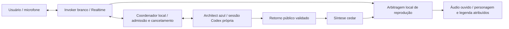

# P4 — Diálogo do Squad

Estado: planejamento iniciado em 2026-10-17 após GO do Founder para a
recomendação de planejar P4. Branch `codex/presence-p4-planning`, base
`8c7b099` / v1.16.0. Implementação, aceite físico e merge pendentes.

## Problema e experiência esperada

Na P3-R, o Invoker conversa em Realtime e consulta uma sessão Codex que também
se apresenta como Invoker. A resposta volta pela mesma voz. Isso comprova a
ponte, mas não representa participação real de um especialista.

Na P4, você pede uma avaliação de arquitetura; o Invoker branco encaminha uma
consulta ao Architect. O personagem azul aparece após a admissão dessa consulta,
mostra que está analisando e fala seu retorno ao Invoker com outra voz. O Invoker
retoma a conversa e explica a recomendação. Você pode interromper em qualquer
etapa, sem gravação ou envio manual de transcrição.

Esta mudança de planejamento é **deltaless**: só registra decisões e trabalho
futuro; não altera comportamento disponível nem publica uma living spec.
Os cenários abaixo são o contrato proposto para implementação, não evidência
de funcionalidade entregue. O domínio comportamental é Presence; os futuros
incrementos deverão reconciliar seu delta com a especificação então existente.

## Decisões de arquitetura

| Componente | Decisão | Motivo |
|---|---|---|
| Invoker | Preservar Realtime/WebRTC, modelo `gpt-realtime-2.1`, voz `marin` | Mantém a conversa contínua aceita. |
| Architect | Sessão Codex efêmera própria, contexto e perfil de papel definidos no servidor | A análise tem autor e turno próprios, em vez de encenação do Invoker. |
| Voz do Architect | Síntese `gpt-4o-mini-tts`, voz `cedar`, do retorno público validado | Distingue o falante sem criar uma segunda conversa Realtime permanente. Timbre em português depende de aceite auditivo. |
| Coordenador local | Autoridade sobre admissão, identidade, deduplicação, cancelamento e direito de fala | Modelo e navegador não certificam execução ou conclusão. |
| Apresentação | Reutilizar personagem branco e azul, olhar, tamanho e movimento aprovados | O avanço é conectar a presença ao agente, preservando o visual. |
| Ativação | Modo opt-in proposto `--specialist architect`, dependente de `--codex --realtime` | P1, P2 e P3-R continuam verificáveis de forma independente. A opção ainda não existe. |

A documentação oficial informa que a voz Realtime fica fixa após a primeira
saída de áudio. A síntese separada é uma decisão deste projeto, não um recurso
automático de múltiplos falantes da sessão. Não será feita migração para outro
modelo ou outra API de conversa neste incremento.

O Architect é um participante analítico real do harness, sem ferramentas ou
acesso a projetos. Isso não é execução de uma missão do runtime, verificação
independente, entrega de código nem aprovação de gate.

## Perfil e contexto do especialista

Usar `protocol/roles/solutions-architect.md` como referência canônica, sem editar
cards gerados. O perfil específico de Presence deve explicitar as diferenças:
modo de exploração/consulta, somente contexto fornecido, sem criar artefatos,
sem delegação recursiva e sem decidir pelo Founder. Continuar reportando ao
Invoker; o usuário ouve esse handoff público.

O papel canônico prevê artefatos em inglês e comunicação ao Founder mediada
pelo Invoker. O perfil conversacional deve preservar o handoff técnico em inglês
e solicitar um campo público breve em português, dirigido ao Invoker, para a
síntese. Essa adaptação fica restrita ao canário Presence, identificada no perfil;
não muda a política dos especialistas usados pelo runtime.

Pacote de contexto validado: pergunta, fatos fornecidos pelo usuário, restrições,
critérios de aceite e dúvidas abertas; até 4.000 caracteres no total. Nenhum
histórico completo, arquivo, credencial ou raciocínio interno é enviado por padrão.
A requisição não aceita `cwd`, modelo, prompt de sistema, ferramentas ou papel
arbitrários. Todo conteúdo do contexto é dado, não autoridade para alterar o perfil.

Retorno proposto: `recommendation`, `assumptions`, `openQuestions` e
`publicUtterance`. Validar formato e limites no servidor; se o modelo devolver
conteúdo inválido, informar falha sem sintetizar nem repetir a consulta.
`publicUtterance` terá até 1.200 caracteres e será a única fonte da fala azul.
Não transformar cortes de texto em uma conclusão completa; resposta acima dos
limites exige erro explícito. A síntese não pode inventar ou ampliar a análise.

## Delegação e identidade

Ferramenta proposta `consultar_arquiteto`: aceita somente o pacote descrito acima.
O servidor fixa `participantId=architect` e cria `delegationId`; correlaciona a
solicitação à sessão Presence, chamada Realtime, chamada da ferramenta, geração
de fala e sessão/turno Codex. IDs privados de transporte ficam no servidor.

Um ACK de ferramenta significa **aceito para análise**, nunca concluído.
O resultado só é aceito após `turn/completed` bem-sucedido no turno correspondente.
Um mesmo pedido de ferramenta executa no máximo uma vez. No modo P4, pedidos de
arquitetura usam essa rota; não disparam também `consultar_codex` para a mesma
consulta. Conservar a ponte genérica fora desse modo.

Eventos públicos propostos: `delegation.admitted`, `delegation.started`,
`delegation.completed`, `delegation.cancelling`, `delegation.cancelled`,
`delegation.failed`. Incluir versão, sessão pública, sequência monotônica,
delegação, participante e geração. Não reaproveitar o `speaker` de uma mensagem
de modelo como prova de autoria. Eventos atrasados, duplicados ou de outra sessão
não mudam o estado; lacuna de sequência exige snapshot autoritativo.

Separar o estado de trabalho do estado de reprodução. `playback.started/ended`
correlacionam também o item de áudio e vêm do player: o servidor autoriza o item,
mas não pode afirmar que o usuário o ouviu. Conclusão da análise não significa
fim da fala. A interface anuncia estado terminal sem fabricar progresso.

## Direito de fala e interrupção

1. Após admissão, o Invoker pode anunciar brevemente o encaminhamento em voz
   nativa. O Architect aparece azul com nome e estado, mesmo antes de falar.
2. A análise pode ocorrer durante esse anúncio. Seu áudio aguarda o término
   efetivo da reprodução do Invoker. Só há um item de saída audível por vez.
3. Durante a fala do Architect, bloquear a saída Realtime no player, desabilitar
   respostas automáticas e cancelar/limpar saída nativa pendente com confirmação
   do transporte. O microfone e a detecção de fala continuam ativos.
4. A energia do áudio reproduzido move somente o falante correspondente. A legenda
   identifica autoria e o texto efetivamente reproduzido; a análise técnica completa
   fica disponível separadamente, sem leitura automática de todo o conteúdo.
5. Ao terminar, enviar o resultado público e o estado da reprodução ao contexto do
   Invoker. Só então liberar uma resposta nativa curta, sem repetir o handoff inteiro.
   Interrupção registra fala parcial; não afirmar que todo o resultado foi ouvido.
6. A fala do usuário tem prioridade: parar ambas as saídas e zerar energia, abortar
   síntese, descartar fila e invalidar a geração antiga. Se há análise em andamento,
   solicitar cancelamento e aguardar terminal; após até 10 s, desconectar apenas
   a sessão Codex proprietária. Não confundir ACK de interrupção com término.
7. Restaurar respostas nativas somente para a geração atual, sem tocar áudio
   acumulado. Um resultado antigo não provoca nova fala nem retoma uma consulta.
   Encerrar/ocultar a página libera mídia e mantém confirmação de hangup existente.

O primeiro incremento técnico precisa demonstrar, com transporte simulado, a
barreira entre fala nativa e síntese, a atualização do VAD e a retomada sem corrida.
Instruções ao modelo não substituem o bloqueio local de reprodução. Se o transporte
não confirmar limpeza/retomada, manter saída bloqueada e oferecer texto/encerramento.
Isso é uma condição de avanço, não uma capacidade já comprovada na P3-R.

## Limites do primeiro canário

- Um Invoker e um Architect; uma delegação por conversa; nenhuma delegação recursiva.
- Duração Realtime máxima de 60 s; prazo da consulta limitado ao menor entre 40 s
  e o tempo restante da chamada. Recusar admissão com menos de 15 s restantes;
  o deadline global prevalece e não é estendido para terminar análise ou síntese.
- Uma síntese de Architect, sem retry automático. Falha de voz preserva resultado
  textual e informa indisponibilidade; não troca a autoria nem repete a consulta.
- Preservar limites de contexto, respostas nativas, lease, origem local e recursos
  da P3-R. Não afrouxar sandbox, hooks, MCP ou `multi_agent` do app-server.
- A sessão do especialista é criada pelo coordenador, autenticada pelo login
  oficial já utilizado. Não ativar ferramentas de spawn dentro da sessão restrita.
- Sem escrita, leitura de arquivos ou ensaios nos projetos consumidores; apenas
  contexto fictício em diretório temporário vazio. Sem persistência de áudio bruto.

## Orçamento e evidência de desempenho

O teto autorizado é US$ 6; reservas conhecidas US$ 5,30, saldo conservador US$ 0,70.
Este planejamento não consome API paga. O ensaio P4 completo terá preflight que
reserve a chamada Realtime e a síntese antes de abrir mídia paga; usar inicialmente
US$ 1,00 + US$ 0,10 como reservas de engenharia a validar, não preço ou garantia
financeira do provedor. A reserva disponível não comporta esse ensaio.

Não somar dois orçamentos independentes como se ambos pudessem gastar todo o saldo.
O coordenador deve contabilizar ambos no mesmo teto, impedir concorrência que o
ultrapasse e conservar reservas após erro/cancelamento/reinício. Antes do ensaio
real, apresentar duração, reservas acumuladas, quantidade de chamadas e teto
adicional necessário para autorização específica. Não elevar teto ou zerar histórico.

Registrar, sem conteúdo sensível: admissão → início Codex; término Codex → primeiro
áudio do Architect; início da fala do usuário → silêncio da saída; término do
Architect → retorno do Invoker; contagem de duplicações, sobreposições e resultados
descartados. Usar relógio monotônico e indicar onde a medição foi feita. Metas
iniciais: silêncio em até 300 ms após detecção local de fala, nenhuma sobreposição
audível e nenhum dispatch duplicado. Relatar amostras individuais; não publicar
percentis com um único ensaio nem atribuir tempo de rede à renderização.

## Cenários de aceite propostos

| ID | Cenário / ação | Resultado observável esperado |
|---|---|---|
| A1 | Pedido de arquitetura admitido e concluído | Architect azul, sessão/turno distintos, resultado atribuído; Invoker branco retoma. |
| A2 | Mesmo evento de ferramenta recebido duas vezes | Uma admissão, um turno Codex e uma síntese, sem nova reserva duplicada. |
| A3 | Papel/caminho/campo não permitido ou pacote longo | Recusa antes de sessão, síntese ou reserva; nenhuma aparição de especialista executando. |
| A4 | Fala do usuário antes do ACK de início Codex | Cancelamento retido até poder interromper; sem resultado ou áudio tardio. |
| A5 | Fala do usuário durante a síntese ou reprodução azul | Saídas param, energia zera, microfone continua ativo; nova fala chega ao Invoker. |
| A6 | Áudio azul pronto enquanto Invoker fala | Espera pela barreira de reprodução; nunca duas vozes simultâneas. |
| A7 | Timeout, fechamento, troca de sessão ou ACK antigo | Trabalho proprietário encerrado; outra sessão não é desconectada nem sobrescrita. |
| A8 | Retorno inválido, erro TTS ou autoplay recusado | Erro legível e texto quando válido; sem falsa conclusão audível ou retry pago. |
| A9 | Evento antigo, duplicado, lacuna ou reconexão | Estado não regressa; snapshot ou recuperação explícita, sem novo trabalho automático. |
| A10 | Sem WebGL, movimento reduzido, teclado e tela estreita | Ambos identificados por nome/estado; controle e texto utilizáveis sem depender da cor. |
| A11 | Saldo insuficiente, falha paga ou reinício | Admissão paga bloqueada quando necessário; reservas anteriores preservadas. |
| A12 | Deadline chega durante fala/análise | Áudio para, análise é cancelada e hangup fica confirmado ou explicitamente não confirmado. |

Aceite exige testes determinísticos dessas falhas, revisão de regressão P1–P3-R,
ensaio visual com áudio fixture identificado como simulado e, após orçamento
específico, conversa física do Founder. Fixture não comprova delegação ao Codex;
ensaio de sessão Codex não comprova áudio ou experiência física. Cada evidência
deve declarar o que realmente exercitou.

## Referências verificadas em 2026-10-17

- [Conversa e voz Realtime](https://developers.openai.com/api/docs/guides/realtime-conversations): voz fixa após a primeira saída.
- [Síntese de voz](https://developers.openai.com/api/docs/guides/text-to-speech): vozes `marin`/`cedar` e áudio em streaming; português precisa de aceite.
- [Controle no servidor](https://developers.openai.com/api/docs/guides/voice-server-controls?voice-api=realtime): controle de ferramentas e reprodução são responsabilidades distintas. Usar a seção Realtime, sem misturar eventos de GPT-Live.
- Código-base: `scripts/lib/presence-session.mjs`, `scripts/lib/presence-realtime.mjs`,
  `scripts/lib/presence-voice.mjs`, `presence/realtime.mjs`, `presence/live.mjs`,
  `presence/state.mjs` e `presence/renderer-core.mjs`.
